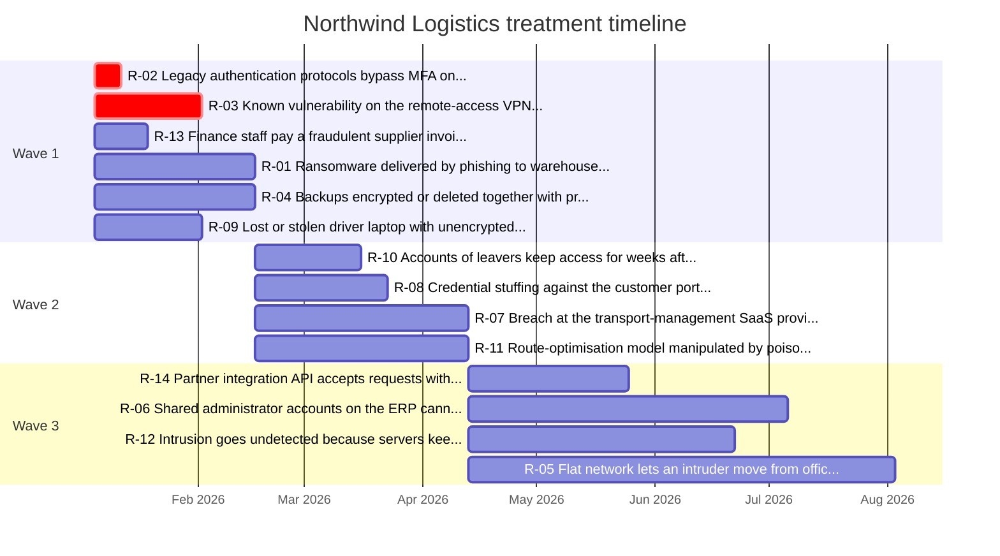

# Northwind Logistics — risk treatment plan

Generated by `rtp` from the risk register. Start date **2026-01-05**, wave budget **12 effort points**, quick win = residual ≥ 10 and effort ≤ 2.

## Summary

| Metric | Value |
|--------|-------|
| Risks in register | 15 |
| Planned for treatment | 14 |
| Accepted (not planned) | 1 |
| Quick wins | 2 |
| Residual rating | 🟢 Low 0 · 🟡 Medium 8 · 🟠 High 6 · 🔴 Critical 1 |
| Total planned effort | 39 points |
| Plan ends | 2026-08-03 |

## Quick wins

High residual score, low effort. Start these this week; they are already in Wave 1 unless the budget pushed them later.

| # | ID | Risk | Owner | Residual | Exposure | Planned control | Effort | Cost | Weeks | Priority | Quick win |
|---|----|------|-------|----------|----------|-----------------|--------|------|-------|----------|-----------|
| 1 | `R-02` | Legacy authentication protocols bypass MFA on the collaboration tenant | Identity and Access Lead | 🟠 12 High | internet | Block legacy authentication with Conditional Access | 1 | Low | 1 | **18.00** | ✅ |
| 2 | `R-03` | Known vulnerability on the remote-access VPN appliance exploited from the internet | Network Lead | 🔴 20 Critical | internet | Patch SLA for internet-facing systems | 2 | Low | 4 | **15.00** | ✅ |

## Wave 1

**2026-01-05 → 2026-02-16** · 6 treatments · 12 effort points · longest control 6 weeks

| # | ID | Risk | Owner | Residual | Exposure | Planned control | Effort | Cost | Weeks | Priority | Quick win |
|---|----|------|-------|----------|----------|-----------------|--------|------|-------|----------|-----------|
| 1 | `R-02` | Legacy authentication protocols bypass MFA on the collaboration tenant | Identity and Access Lead | 🟠 12 High | internet | Block legacy authentication with Conditional Access | 1 | Low | 1 | **18.00** | ✅ |
| 2 | `R-03` | Known vulnerability on the remote-access VPN appliance exploited from the internet | Network Lead | 🔴 20 Critical | internet | Patch SLA for internet-facing systems | 2 | Low | 4 | **15.00** | ✅ |
| 3 | `R-13` | Finance staff pay a fraudulent supplier invoice after a spoofed e-mail | Finance Systems Owner | 🟡 9 Medium | internet | Security awareness programme with phishing simulations | 1 | Low | 2 | **13.50** |  |
| 4 | `R-01` | Ransomware delivered by phishing to warehouse workstations | IT Operations Manager | 🟠 15 High | internal | Deploy EDR to warehouse and office workstations | 3 | Medium | 6 | **5.00** |  |
| 5 | `R-04` | Backups encrypted or deleted together with production during an attack | IT Operations Manager | 🟠 15 High | internal | Immutable off-site backup copies | 3 | Medium | 6 | **5.00** |  |
| 6 | `R-09` | Lost or stolen driver laptop with unencrypted delivery manifests | IT Operations Manager | 🟡 9 Medium | internal | Full-disk encryption on all laptops | 2 | Low | 4 | **4.50** |  |

## Wave 2

**2026-02-16 → 2026-04-13** · 4 treatments · 11 effort points · longest control 8 weeks

| # | ID | Risk | Owner | Residual | Exposure | Planned control | Effort | Cost | Weeks | Priority | Quick win |
|---|----|------|-------|----------|----------|-----------------|--------|------|-------|----------|-----------|
| 7 | `R-10` | Accounts of leavers keep access for weeks after departure | Identity and Access Lead | 🟡 9 Medium | internal | Quarterly access review workflow | 2 | Low | 4 | **4.50** |  |
| 8 | `R-08` | Credential stuffing against the customer portal login | Digital Products Owner | 🟡 9 Medium | internet | Web application firewall for the customer portal | 3 | Medium | 5 | **4.50** |  |
| 9 | `R-07` | Breach at the transport-management SaaS provider exposes shipment and customer data | Procurement Lead | 🟡 9 Medium | partner | Supplier security assessment programme | 3 | Low | 8 | **3.75** |  |
| 10 | `R-11` | Route-optimisation model manipulated by poisoned partner data feeds | Data and AI Lead | 🟡 8 Medium | partner | AI model input validation and output monitoring | 3 | Medium | 8 | **3.33** |  |

## Wave 3

**2026-04-13 → 2026-08-03** · 4 treatments · 16 effort points · longest control 16 weeks

| # | ID | Risk | Owner | Residual | Exposure | Planned control | Effort | Cost | Weeks | Priority | Quick win |
|---|----|------|-------|----------|----------|-----------------|--------|------|-------|----------|-----------|
| 11 | `R-14` | Partner integration API accepts requests without authentication | Digital Products Owner | 🟡 8 Medium | partner | API authentication and rate limiting | 3 | Medium | 6 | **3.33** |  |
| 12 | `R-06` | Shared administrator accounts on the ERP cannot be attributed to a person | ERP Application Owner | 🟠 12 High | internal | Privileged access management for ERP and infrastructure | 4 | High | 12 | **3.00** |  |
| 13 | `R-12` | Intrusion goes undetected because servers keep only local logs | Security Operations Lead | 🟠 12 High | internal | Central logging and SIEM onboarding | 4 | Medium | 10 | **3.00** |  |
| 14 | `R-05` | Flat network lets an intruder move from office PCs to conveyor controllers | Network Lead | 🟠 12 High | internal | Segment the OT and warehouse networks | 5 | High | 16 | **2.40** |  |

## Accepted risks (not planned)

Listed for the record. Acceptance needs a named approver and a review date; re-run the plan when a risk is no longer accepted.

| ID | Risk | Owner | Residual | Existing controls |
|----|------|-------|----------|-------------------|
| `R-15` | HR data sent to personal e-mail addresses by staff working from home | HR Systems Owner | 🟡 6 Medium | Acceptable use policy signed yearly |

## Owner workload

| Owner | Risks | Planned | Effort | In Wave 1 | Quick wins | Highest residual |
|-------|-------|---------|--------|-----------|------------|------------------|
| IT Operations Manager | 3 | 3 | 8 | 3 | 0 | 🟠 High |
| Network Lead | 2 | 2 | 7 | 1 | 1 | 🔴 Critical |
| Digital Products Owner | 2 | 2 | 6 | 0 | 0 | 🟡 Medium |
| ERP Application Owner | 1 | 1 | 4 | 0 | 0 | 🟠 High |
| Security Operations Lead | 1 | 1 | 4 | 0 | 0 | 🟠 High |
| Identity and Access Lead | 2 | 2 | 3 | 1 | 1 | 🟠 High |
| Data and AI Lead | 1 | 1 | 3 | 0 | 0 | 🟡 Medium |
| Procurement Lead | 1 | 1 | 3 | 0 | 0 | 🟡 Medium |
| Finance Systems Owner | 1 | 1 | 1 | 1 | 0 | 🟡 Medium |
| HR Systems Owner | 1 | 0 | 0 | 0 | 0 | 🟡 Medium |

## Timeline

## Method

`priority = residual score × exposure weight ÷ effort`, where residual score = residual likelihood × residual impact on the 5×5 grid (Low 1–4 · Medium 5–9 · High 10–16 · Critical 17–25), exposure weight = internet 1.5 · partner 1.25 · internal 1 · isolated 0.75, and effort is 1 (trivial) to 5 (programme) from the treatment catalogue. Ties break on residual score, then lower effort, then ID. Waves are filled in rank order until the cumulative effort budget is reached; the last wave takes the rest. Each wave lasts as long as its slowest control.
